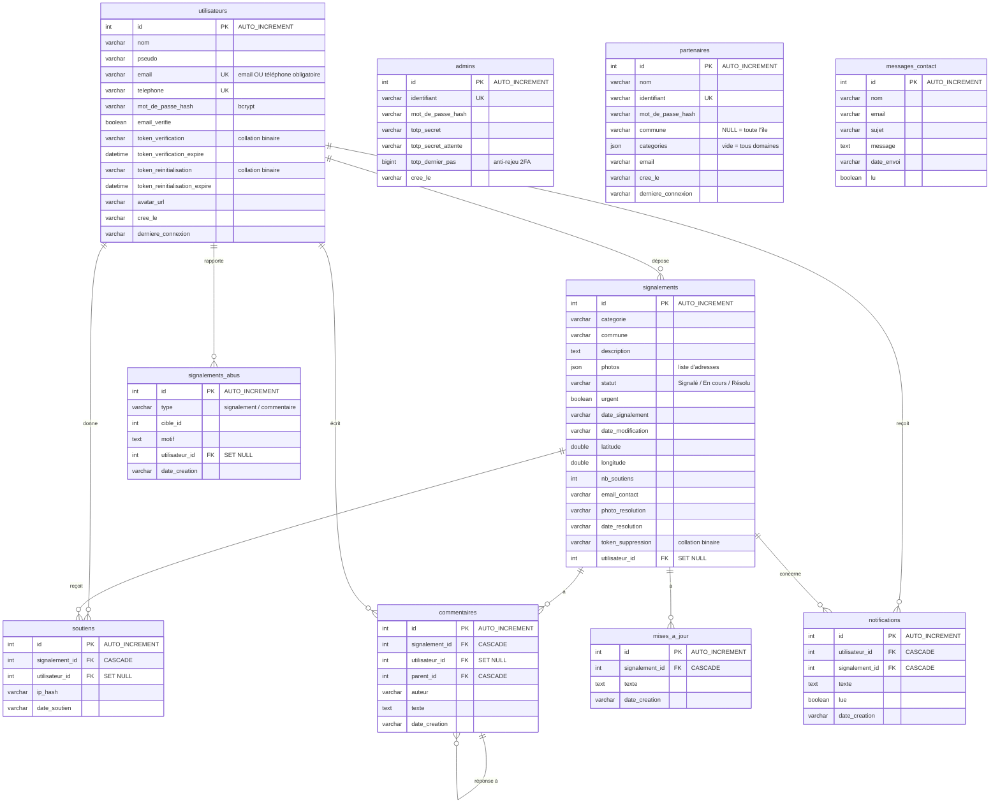

# Base de données — Signale Mayotte

Le projet utilise **deux bases**, chacune pour ce qu'elle fait le mieux :

| Base        | Type                | Rôle                                                            | Code d'accès                                                      |
| ----------- | ------------------- | --------------------------------------------------------------- | ----------------------------------------------------------------- |
| **MariaDB** | Relationnelle (SQL) | Données métier : signalements, comptes, commentaires, soutiens… | [`server/db.js`](../server/db.js) + routes, via `mysql2`          |
| **NeDB**    | Documents (NoSQL)   | Journal d'activité (connexions, actions sensibles)              | [`server/journal.js`](../server/journal.js), via `@seald-io/nedb` |

**Où vit la base :** MariaDB est installé sur le poste du développeur, avec deux bases :
`signale_mayotte` (développement) et `signale_mayotte_test` (tests automatiques, vidée à
chaque passage). On les consulte avec **DBeaver**, connexion « Signale Mayotte » : tables,
données, et diagramme entité-relation généré automatiquement (clic droit sur _Tables_ →
_Afficher le diagramme_).

L'application se connecte avec un compte dédié, `signale`, qui n'a de droits que sur ces
deux bases (**principe du moindre privilège**) : jamais avec le compte administrateur `root`.

Le schéma est créé automatiquement au premier démarrage du serveur (`CREATE TABLE IF NOT
EXISTS` dans [`server/db.js`](../server/db.js)) : une base vide arrive seule au bon état.
Toutes les tables sont en **InnoDB** (clés étrangères et transactions) et en **utf8mb4**
(accents, emojis).

---

## 1. Modèle conceptuel de données (MCD)

Entités et associations, avec leurs cardinalités (notation Merise).

```
 UTILISATEUR ─(0,n)── DÉPOSE ──(0,1)─ SIGNALEMENT
 UTILISATEUR ─(0,n)── SOUTIENT ─(0,n)─ SIGNALEMENT        (porte : date_soutien)
 UTILISATEUR ─(0,n)── ÉCRIT ───(0,1)─ COMMENTAIRE ─(1,1)── CONCERNE ──(0,n)─ SIGNALEMENT
 COMMENTAIRE ─(0,n)── RÉPOND À ─(0,1)─ COMMENTAIRE        (réponses en fil)
 SIGNALEMENT ─(0,n)── A ───────(1,1)─ MISE_À_JOUR
 UTILISATEUR ─(0,n)── REÇOIT ──(1,1)─ NOTIFICATION ─(0,1)── PORTE SUR ─(0,n)─ SIGNALEMENT
 UTILISATEUR ─(0,n)── RAPPORTE ─(0,1)─ SIGNALEMENT_ABUS
 ADMIN, PARTENAIRE, MESSAGE_CONTACT : entités indépendantes
```

Lecture d'une ligne : _un utilisateur dépose 0 à n signalements ; un signalement est
déposé par 0 ou 1 utilisateur_ (0 : signalement anonyme, ou compte supprimé depuis).

### Règles de gestion principales

- **RG-01** Un signalement peut être déposé sans compte ; s'il l'est avec un compte, il y reste rattaché.
- **RG-02** Un utilisateur ne soutient qu'**une seule fois** un même signalement (contrainte `UNIQUE (signalement_id, utilisateur_id)`).
- **RG-03** Un compte citoyen a au moins un moyen de contact : email **ou** téléphone (contrainte `CHECK`).
- **RG-04** Supprimer un compte **ne supprime pas** ses signalements ni ses commentaires : ils deviennent anonymes (`ON DELETE SET NULL`).
- **RG-05** Supprimer un signalement supprime ses commentaires, soutiens, mises à jour et notifications (`ON DELETE CASCADE`).
- **RG-06** Supprimer un commentaire supprime ses réponses (`ON DELETE CASCADE` sur `parent_id`).
- **RG-07** Un même utilisateur ne signale qu'une fois un même contenu abusif (unicité `type, cible_id, utilisateur_id`).
- **RG-08** Les identifiants des admins et des partenaires sont uniques.

---

## 2. Modèle logique de données (MLD)

Clé primaire en **gras**, clé étrangère précédée de `#`.

- **utilisateurs** (**id**, nom, pseudo, email, telephone, mot_de_passe_hash, email_verifie, token_verification, token_verification_expire, token_reinitialisation, token_reinitialisation_expire, avatar_url, cree_le, derniere_connexion)
- **signalements** (**id**, categorie, commune, description, photos, statut, urgent, date_signalement, date_modification, latitude, longitude, nb_soutiens, email_contact, photo_resolution, date_resolution, token_suppression, #utilisateur_id)
- **soutiens** (**id**, #signalement_id, #utilisateur_id, ip_hash, date_soutien)
- **commentaires** (**id**, #signalement_id, #utilisateur_id, #parent_id, auteur, texte, date_creation)
- **mises_a_jour** (**id**, #signalement_id, texte, date_creation)
- **notifications** (**id**, #utilisateur_id, #signalement_id, texte, lue, date_creation)
- **signalements_abus** (**id**, type, cible_id, motif, #utilisateur_id, date_creation)
- **admins** (**id**, identifiant, mot_de_passe_hash, totp_secret, totp_secret_attente, totp_dernier_pas, cree_le)
- **partenaires** (**id**, nom, identifiant, mot_de_passe_hash, commune, categories, email, cree_le, derniere_connexion)
- **messages_contact** (**id**, nom, email, sujet, message, date_envoi, lu)

> `signalements_abus.cible_id` pointe vers un signalement **ou** un commentaire selon
> `type` : c'est une association polymorphe, donc sans clé étrangère SQL. Le contrôle est
> fait par le code serveur.

> `signalements.photos` (jusqu'à 5 adresses de photos) et `partenaires.categories` (les
> domaines d'un partenaire) sont des **colonnes JSON** contenant une liste. MariaDB vérifie
> que leur contenu est un JSON valide (`CHECK (JSON_VALID(...))`, ajouté automatiquement au
> type `JSON`). Une table séparée aurait aussi été possible ; la liste suffit ici, car ces
> valeurs sont toujours lues et écrites en bloc avec leur ligne.

---

## 3. Modèle physique (diagramme)

Types MariaDB réels. `VARCHAR(30)` pour les dates au format ISO 8601
(`2026-11-15T21:00:00.000Z`), renvoyées telles quelles à l'API et triables par ordre
alphabétique ; `DATETIME` (UTC) pour les expirations, comparées par la base à
`UTC_TIMESTAMP()`.



`BOOLEAN` est, dans MariaDB, un `TINYINT(1)` qui vaut 0 ou 1. Le composant d'accès le
reconvertit en `true` / `false` pour que l'API renvoie de vrais booléens.

### Index et contraintes notables

| Objet                                                                               | Rôle                                                                                |
| ----------------------------------------------------------------------------------- | ----------------------------------------------------------------------------------- |
| `soutiens_signalement_utilisateur_uniq` : `UNIQUE (signalement_id, utilisateur_id)` | Un seul soutien par compte et par signalement (RG-02)                               |
| `idx_notifications_utilisateur (utilisateur_id, lue)`                               | Compte rapide des notifications non lues (cloche)                                   |
| `idx_signalements_date (date_signalement)`                                          | Liste des signalements triée du plus récent au plus ancien                          |
| `utilisateurs_email_ou_telephone` (`CHECK`)                                         | RG-03                                                                               |
| `abus_unique` : `UNIQUE (type, cible_id, utilisateur_id)`                           | RG-07                                                                               |
| Clés étrangères nommées (`fk_…`) avec `ON DELETE CASCADE` / `SET NULL`              | RG-04, RG-05, RG-06 : la base garantit elle-même la cohérence lors des suppressions |

---

## 4. Le composant d'accès aux données SQL ([`server/db.js`](../server/db.js))

Tout le code passe par un seul objet `db` :

| Méthode                     | Rôle                                                                                  |
| --------------------------- | ------------------------------------------------------------------------------------- |
| `db.query(sql, parametres)` | Exécute une requête et renvoie `{ rows, rowCount, insertId }`                         |
| `db.connect()`              | Ouvre une connexion dédiée pour une **transaction** (`BEGIN` … `COMMIT` / `ROLLBACK`) |
| `db.end()`                  | Ferme le groupe de connexions (pool) : arrêt du serveur, fin des tests                |

Exemple de transaction : la suppression d'un compte ([`server/compte.js`](../server/compte.js))
efface ou anonymise tous ses contenus d'un seul bloc ; si une étape échoue, `ROLLBACK`
annule tout, et aucune donnée personnelle ne reste à moitié effacée.

### Sécurité

- **Requêtes préparées partout** : chaque valeur est un `?` dans le SQL et passe dans le
  tableau `parametres`, jamais collée dans le texte. C'est la protection contre l'injection SQL.
- **Liste blanche** pour ce qui ne peut pas être un paramètre (le sens du tri, `TRIS` dans
  les signalements).
- Compte de base de données **à droits limités** (`signale`), jamais `root`.
- Mots de passe hachés avec **bcrypt** ; jetons de vérification et de réinitialisation avec
  **date d'expiration** et en **collation binaire** (comparaison exacte, majuscules comprises).
- En production, connexion **chiffrée (TLS)** avec vérification du certificat ; en local
  (`localhost`), connexion directe.

### Requêtes à connaître pour l'oral

```sql
-- Liste filtrée et paginée (les ? sont remplacés par les valeurs, dans l'ordre)
SELECT s.*, u.nom AS auteur_nom
FROM signalements s
LEFT JOIN utilisateurs u ON u.id = s.utilisateur_id
WHERE commune = ? AND statut = ?
ORDER BY urgent DESC, date_signalement DESC
LIMIT ? OFFSET ?;

-- Statistiques par commune
SELECT commune, COUNT(*) AS count FROM signalements GROUP BY commune ORDER BY count DESC;

-- Partenaires concernés par un nouveau signalement (colonne JSON)
SELECT id, nom, email FROM partenaires
WHERE email IS NOT NULL
  AND (commune IS NULL OR commune = ?)
  AND (JSON_LENGTH(categories) = 0 OR JSON_CONTAINS(categories, JSON_QUOTE(?)));
```

---

## 5. Base NoSQL : le journal d'activité (NeDB)

**NeDB** est une base de données NoSQL **orientée documents**, embarquée dans
l'application : pas de serveur à installer, la base vit dans un fichier,
`server/data/journal/journal-activite.db` (ignoré par git). Chaque ligne du fichier est un
document JSON : on peut l'ouvrir dans VS Code et voir exactement ce qui est enregistré.
Son langage de requête reprend celui de MongoDB (`$gte`, `sort`, `skip`, `limit`…).

### Pourquoi NoSQL pour ce journal, et SQL pour le reste

| Données                                        | Besoin                                                                                                                    | Choix                                                          |
| ---------------------------------------------- | ------------------------------------------------------------------------------------------------------------------------- | -------------------------------------------------------------- |
| Signalements, comptes, commentaires, soutiens… | Relations entre tables, contraintes (unicité, clés étrangères), transactions                                              | **SQL** (MariaDB) : la base garantit la cohérence              |
| Journal d'activité                             | Chaque événement a une forme différente ; on ajoute beaucoup, on lit du plus récent au plus ancien, on efface après un an | **NoSQL** (NeDB) : un document par événement, sans schéma fixe |

En SQL, le journal demanderait une table par type d'événement, ou une colonne
fourre-tout ; en NoSQL, chaque document porte exactement ses propres champs.

### Forme d'un document

```json
{
  "_id": "kE3x9pQ2mVb7LwRt",
  "date": { "$$date": 1763242392512 },
  "type": "signalement.statut",
  "resultat": "succes",
  "acteur": { "type": "partenaire", "id": 4, "nom": "Services techniques Koungou" },
  "cible": { "type": "signalement", "id": 128 },
  "details": { "avant": "Signalé", "apres": "En cours" }
}
```

Un événement de connexion n'a ni `cible` ni `details` : les champs absents ne sont
simplement pas écrits. C'est ce qu'on appelle un **schéma flexible**.

### Index

| Index                                    | Rôle                                                                                             |
| ---------------------------------------- | ------------------------------------------------------------------------------------------------ |
| `date` avec `expireAfterSeconds` (365 j) | **Index TTL** : la base efface seule les événements de plus d'un an (RGPD), sans tâche planifiée |
| `type`                                   | Filtre rapide par type d'événement                                                               |

### Opérations du composant d'accès ([`server/journal.js`](../server/journal.js))

| Fonction                            | Opération NoSQL                                                                     |
| ----------------------------------- | ----------------------------------------------------------------------------------- |
| `journaliser()`                     | `insertAsync` — sans attendre la réponse : le journal ne ralentit jamais la requête |
| `lireJournal()`                     | `findAsync(filtre)` + `sort` + `skip` + `limit` + `countAsync` (pagination)         |
| `statistiquesJournal()`             | `findAsync({ date: { $gte: depuis } })` puis regroupement par type                  |
| `viderJournal()`, `fermerJournal()` | Tests et arrêt propre                                                               |

Ces opérations sont vérifiées par des tests automatiques
([`server/tests/unitaires/journal.test.js`](../server/tests/unitaires/journal.test.js)) :
documents à champs libres, filtres, pagination, statistiques.

**Sécurité :** les filtres de lecture viennent d'une liste fermée (`TYPES_EVENEMENTS`,
`RESULTATS`) validée par la route : aucun objet issu de la requête n'entre dans un filtre
NoSQL, ce qui écarte l'injection d'opérateurs (`$ne`, `$gt`, `$where`…).

**Résilience :** si le fichier du journal ne peut pas être ouvert, le journal est
simplement indisponible ; le reste du site fonctionne normalement.

**Hébergement :** en production chez alwaysdata, le disque est permanent : le journal est
conservé d'une mise à jour à l'autre (voir [`deploiement.md`](deploiement.md)).
