# Maquettage — Signale Mayotte

Ce document décrit le **zonage** (wireframes) des écrans principaux, les parcours
utilisateurs et la charte graphique. Il sert de base aux maquettes graphiques haute
fidélité (Figma ou équivalent), à joindre au dossier.

Démarche suivie : **zoning → wireframe basse fidélité → maquette → intégration**, en
partant du mobile (_mobile first_). La majorité des habitants de Mayotte accède à Internet
depuis un téléphone.

---

## 1. Arborescence du site

```
Accueil (/)
├── Signaler un problème (/signaler)
├── Détail d'un signalement (/signalements/:id)
├── Carte (/carte)
├── Transparence — statistiques publiques (/transparence)
├── Contact (/contact)
├── Confidentialité (/confidentialite)
├── Compte citoyen
│   ├── Inscription (/inscription) → Vérifier l'email (/verifier-email)
│   ├── Connexion (/connexion)
│   ├── Mot de passe oublié (/mot-de-passe-oublie) → Réinitialiser (/reinitialiser-mot-de-passe)
│   ├── Mes signalements (/mes-signalements)
│   └── Profil (/profil)
├── Espace partenaire (/partenaire/login → /partenaire)
├── Espace admin (adresse secrète VITE_CHEMIN_ADMIN, /admin par défaut)
└── Page 404
```

## 2. Profils et parcours principaux

| Profil                           | Besoin                                       | Parcours                                                                                                           |
| -------------------------------- | -------------------------------------------- | ------------------------------------------------------------------------------------------------------------------ |
| **Habitant** (sans compte)       | Signaler vite un problème                    | Accueil → Signaler → formulaire (catégorie, commune, description, photo, position) → confirmation                  |
| **Habitant** (avec compte)       | Suivre ses signalements, soutenir, commenter | Connexion → Mes signalements → Détail → statut, commentaires                                                       |
| **Partenaire** (agent municipal) | Traiter les signalements de son périmètre    | Connexion partenaire → tableau de bord → changer le statut → l'habitant est notifié                                |
| **Administrateur**               | Modérer et gérer les comptes                 | Connexion + code 2FA → tableau de bord (aperçu, signalements, modération, messages, partenaires, comptes, journal) |

---

## 3. Zonage des écrans

### 3.1 Accueil — desktop

```
┌──────────────────────────────────────────────────────────────┐
│  SIGNALE MAYOTTE                              ╭───────────╮  │
│  Signalez les problèmes de votre commune      │  globe 3D  │  │  ← HERO
│  accroche (déchets, routes, éclairage, eau)   │  animé     │  │
│  [ Faire un signalement ]  (N signalements)   ╰───────────╯  │  ← Appel à l'action principal
│                                                              │
│        ╭─ 🏠 Accueil  ⚠  📍  💬  📊  👤 ─╮                 ☀  │  ← Barre de navigation flottante
├──────────────────────────────────────────────────────────────┤     (en bas, icônes) + thème
│   COMMENT ÇA MARCHE :  ① Je signale  ② C'est transmis  ③ Suivi│
├──────────────────────────────────────────────────────────────┤
│  Derniers signalements de Mayotte                            │
│  [Recherche…] [Commune ▾] [Catégorie ▾] [Statut ▾] [Tri ▾] ☐ Urgents │  ← Barre de filtres
│  12 signalements                                             │
│  ┌──────────┐ ┌──────────┐ ┌──────────┐                      │
│  │ photo    │ │ photo    │ │ photo    │                      │  ← Cartes (3 colonnes)
│  │ commune  │ │ commune  │ │ commune  │                      │
│  │ statut   │ │ statut   │ │ statut   │                      │
│  └──────────┘ └──────────┘ └──────────┘                      │
│                 « 1  2  3 »                                  │  ← Pagination
├──────────────────────────────────────────────────────────────┤
│ Pied de page : liens, confidentialité, contact               │
└──────────────────────────────────────────────────────────────┘
```

### 3.2 Accueil — mobile

```
┌────────────────────┐
│  HERO (globe en    │
│  fond, titre)      │
│ [Faire un signal.] │  ← appel à l'action
├────────────────────┤
│  ① ② ③ (empilés)   │
├────────────────────┤
│ Filtres (empilés)  │  ← un champ par ligne
│ ┌────────────────┐ │
│ │ carte 1        │ │  ← 1 colonne
│ └────────────────┘ │
│ ┌────────────────┐ │
│ │ carte 2        │ │
│ └────────────────┘ │
│╭ 🏠 ⚠ 📍 💬 📊 👤 ╮☀│  ← navigation fixée en bas,
└────────────────────┘     à portée du pouce
```

Grille Bootstrap : `col-12` (mobile) → `col-md-6` (tablette) → `col-xl-4` (grand écran).

### 3.3 Signaler un problème

```
┌──────────────────────────────────────────────────────────────┐
│ ┌───────────────────────┐ ┌────────────────────────────────┐ │
│ │ NOUVEAU SIGNALEMENT   │ │ Catégorie        [ ▾ ]         │ │
│ │ Signaler un problème  │ │  → Organisme compétent affiché │ │
│ │ texte d'aide          │ │ Commune          [ ▾ ]         │ │
│ │                       │ │ Description      [_________]   │ │
│ │                       │ │ Email (facultatif)             │ │
│ │                       │ │ Photos [ glisser-déposer ]     │ │
│ │                       │ │ ☐ Urgent (danger immédiat)     │ │
│ │                       │ │ Localisation                   │ │
│ │                       │ │ ┌────────────────────────────┐ │ │
│ │                       │ │ │ CARTE : clic = position    │ │ │
│ │                       │ │ │ [Utiliser ma position]     │ │ │
│ │                       │ │ └────────────────────────────┘ │ │
│ │                       │ │ Doublons proches ? [Soutenir]  │ │
│ │                       │ │ [ Envoyer le signalement ]     │ │
│ └───────────────────────┘ └────────────────────────────────┘ │
│              ╭─ 🏠  ⚠ Signaler  📍  💬  📊  👤 ─╮             │
└──────────────────────────────────────────────────────────────┘
```

Deux colonnes sur grand écran (`col-lg-5` / `col-lg-7`), une seule sur mobile. Les
erreurs s'affichent sous chaque champ. Si un signalement semblable existe à moins de
400 m, il est proposé pour être soutenu plutôt que dupliqué.

### 3.4 Détail d'un signalement

```
┌──────────────────────────────────────────────────────────────┐
│ ← Retour                                                     │
│ Mamoudzou · Voirie · [En cours]  ⚠ Urgent                    │
│ ┌─────────────────────────┐  Suivi : Signalé → En cours → Résolu│
│ │ Galerie photos          │  👍 Soutenir (12)  🚩 Signaler ce contenu │
│ └─────────────────────────┘  Mini-carte                      │
│ Description                                                  │
│ Mises à jour publiées (chronologie)                          │
│ Commentaires (fil + réponses)   [ Écrire un commentaire ]    │
└──────────────────────────────────────────────────────────────┘
```

### 3.5 Carte

```
┌──────────────────────────────────────────────────────────────┐
│ ┌─────────────────────────┐                                  │
│ │ CARTE DES SIGNALEMENTS  │     CARTE PLEIN ÉCRAN            │
│ │ N signalements localisés│     un marqueur par signalement  │
│ │ [Communes ▾]            │        ● (rouge = Signalé)       │
│ │ [Catégories ▾]          │        ● (orange = En cours)     │
│ │ [Statuts ▾]             │        ● (vert = Résolu)         │
│ │ légende ● ● ●           │     clic = aperçu + lien détail  │
│ └─────────────────────────┘                                  │
│              ╭─ 🏠  ⚠  📍 Carte  💬  📊  👤 ─╮           ☀   │
└──────────────────────────────────────────────────────────────┘
```

Le panneau de filtres flotte au-dessus de la carte, qui occupe tout l'écran.

### 3.6 Espace administrateur

```
┌──────────┬───────────────────────────────────────────────────┐
│ Aperçu   │  Tableau de bord                                  │
│ Signalem.│  ┌──────┐ ┌──────┐ ┌──────┐ ┌──────┐              │
│ Modérat. │  │Total │ │Signalé│ │En cours│ │Résolu│             │  ← indicateurs
│ Messages │  └──────┘ └──────┘ └──────┘ └──────┘              │
│ Partenair│  Derniers signalements (tableau)                  │
│ Comptes  │  ┌──────────────────────────────────────────────┐ │
│ Journal  │  │ # │ commune │ catégorie │ statut ▾ │ actions  │ │
│          │  └──────────────────────────────────────────────┘ │
│ [Export CSV]                                                 │
└──────────┴───────────────────────────────────────────────────┘
```

Menu latéral à sept sections. Sur mobile, il devient une rangée d'onglets défilante.

### 3.7 Espace partenaire

```
┌──────────────────────────────────────────────────────────────┐
│ Bonjour, Services techniques — périmètre : Koungou · Voirie  │
│ « 3 nouveaux signalements depuis votre dernière connexion »  │
│ [Filtres]                                                    │
│ Tableau : signalement │ commune │ catégorie │ statut [▾ changer] │
└──────────────────────────────────────────────────────────────┘
```

---

### 3.8 Wireframes (basse fidélité)

Le zonage ci-dessus est détaillé en **wireframes** : noir et blanc, blocs gris pour le
texte, cases barrées d'une croix pour les images, et pastilles rouges numérotées
renvoyant aux annotations. Ils fixent la disposition et les priorités de chaque écran
avant le travail sur les couleurs. Source : [`maquettes/wireframes/wireframes.html`](maquettes/wireframes/wireframes.html),
images générées par `node docs/maquettes/wireframes/capturer.mjs`.

| Écran                  | Ordinateur                                                                     | Mobile                                                                 |
| ---------------------- | ------------------------------------------------------------------------------ | ---------------------------------------------------------------------- |
| Accueil                | 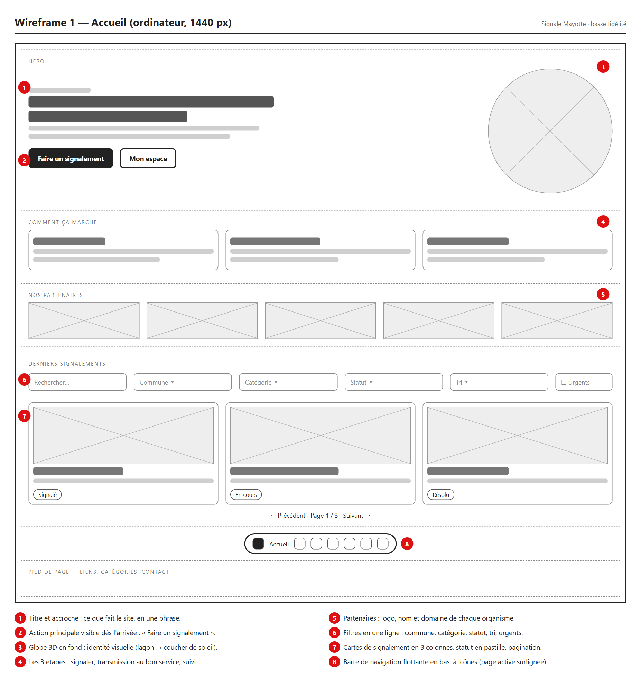   | 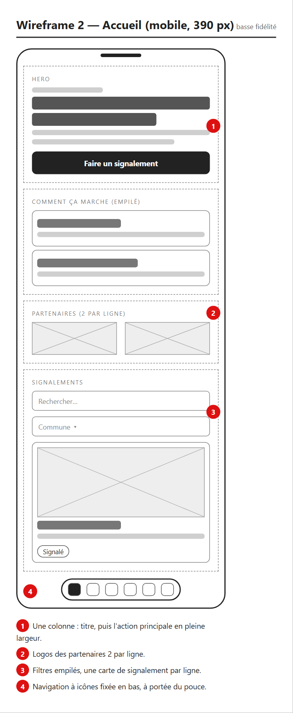   |
| Signaler un problème   | 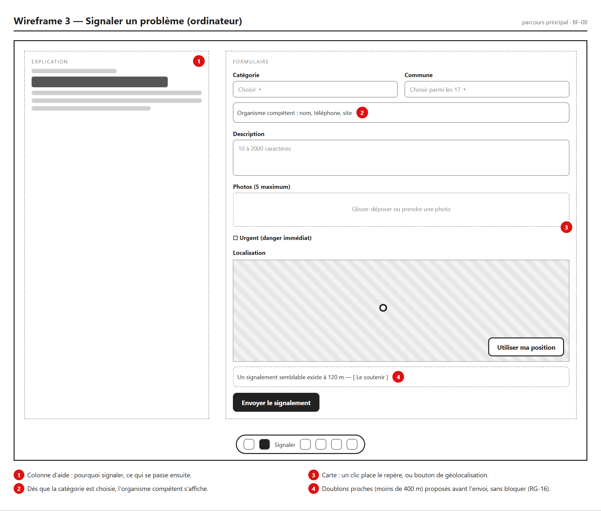 | 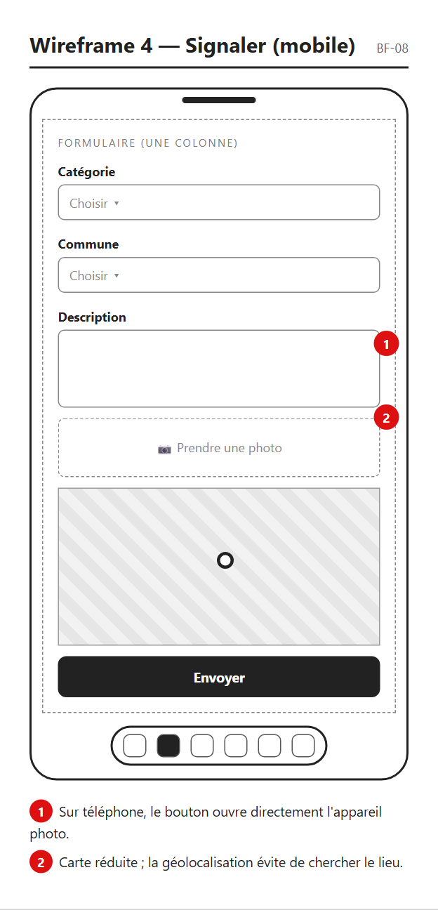 |
| Fiche d'un signalement | 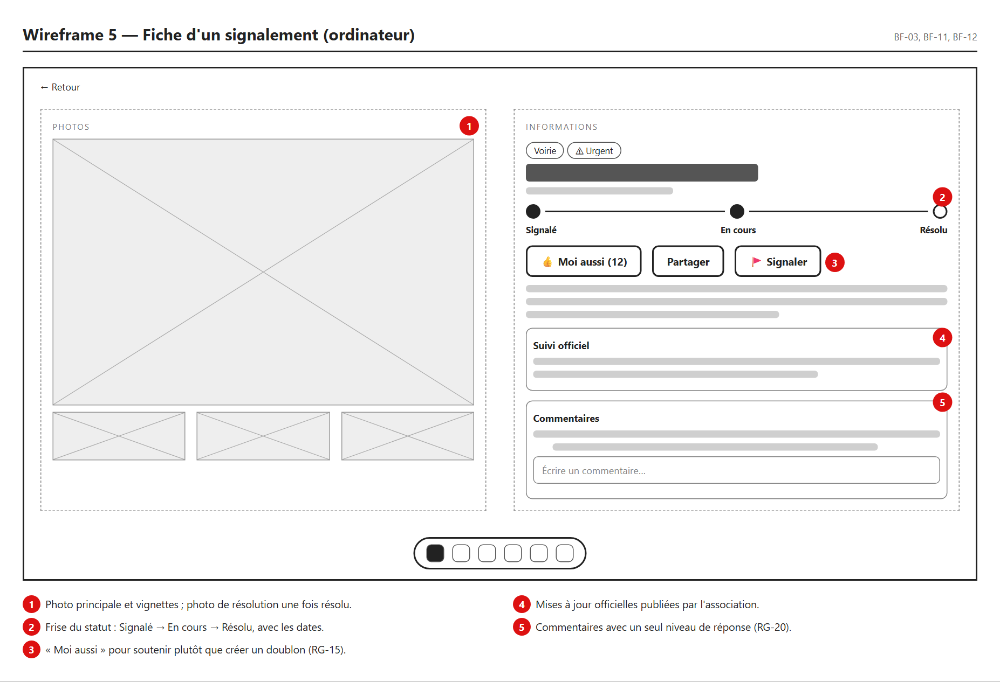       | —                                                                      |
| Carte des signalements | 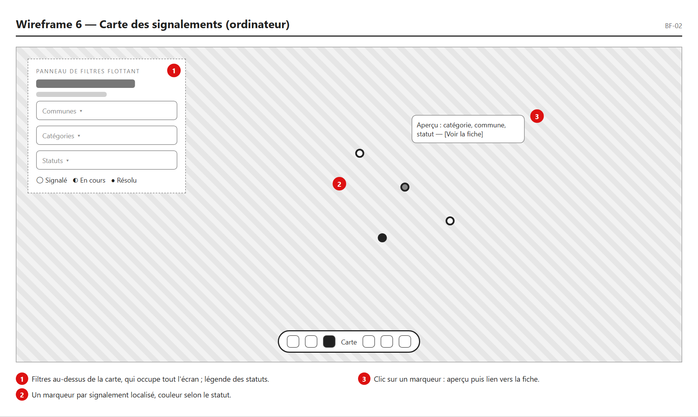       | —                                                                      |

### 3.9 Maquette graphique (haute fidélité)

La planche [`charte-graphique.png`](maquettes/wireframes/charte-graphique.png) applique la
charte (section 4) aux composants : couleurs, typographie Inter, boutons, pastilles de
statut, panneau « verre dépoli », carte de signalement, carte partenaire et barre de
navigation, sur le fond réel du site.

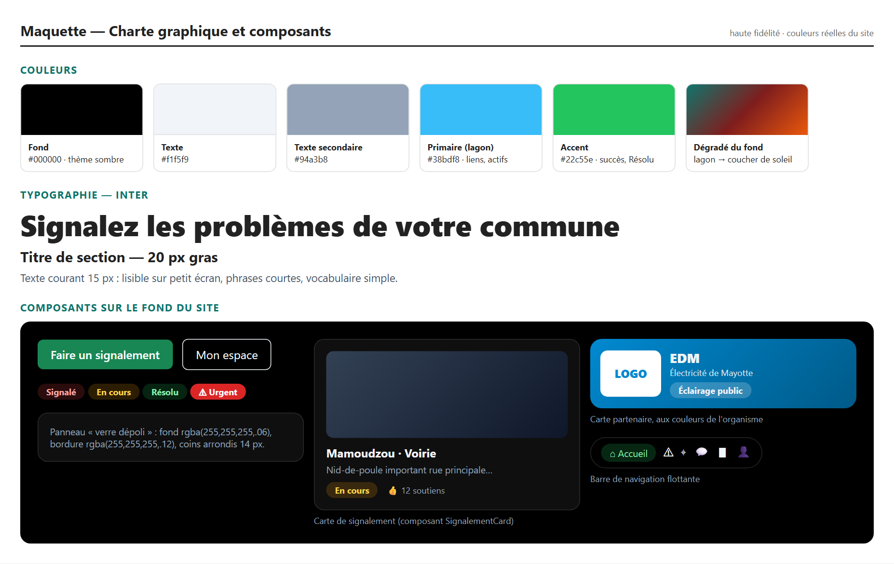

### 3.10 Captures du site réalisé

Résultat de l'intégration, capturé sur le site en ligne (ordinateur 1440 × 900, mobile 390 × 844).

| Écran           | Ordinateur                                                           | Mobile                                                          |
| --------------- | -------------------------------------------------------------------- | --------------------------------------------------------------- |
| Accueil         | 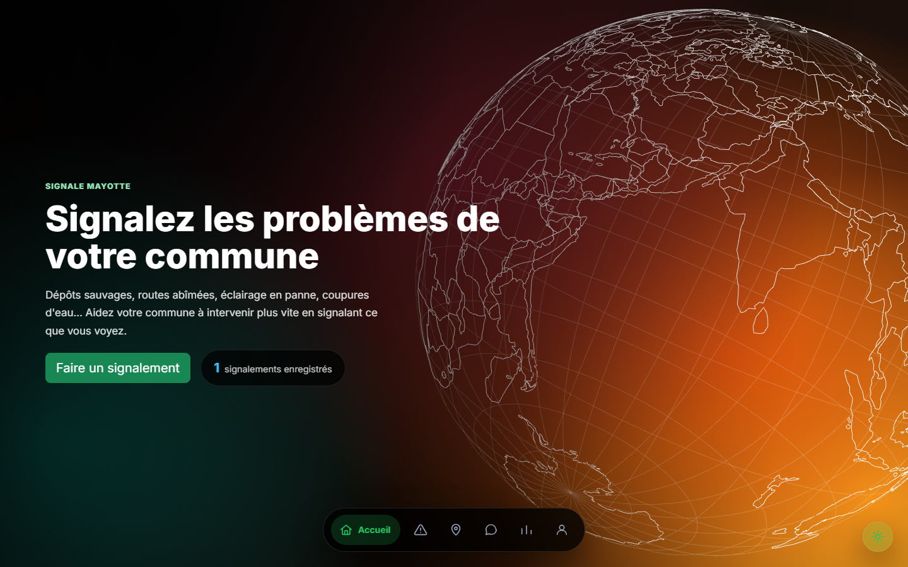                 | 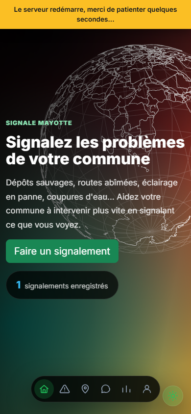                 |
| Carte           | 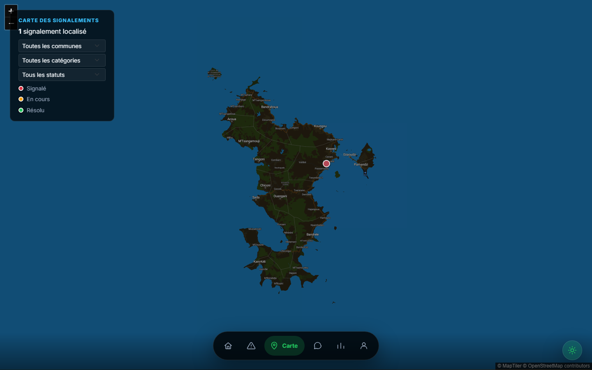                     | 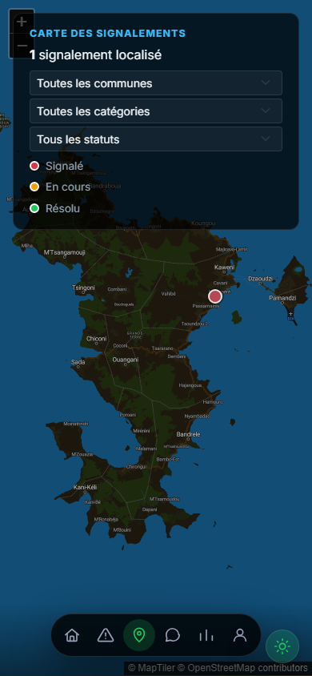                     |
| Transparence    | 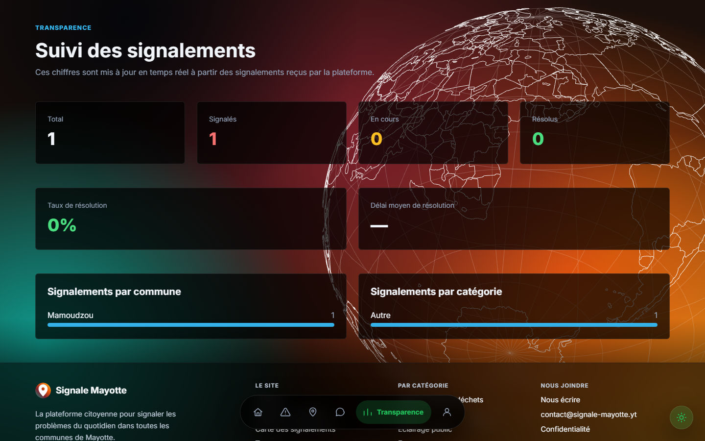       | 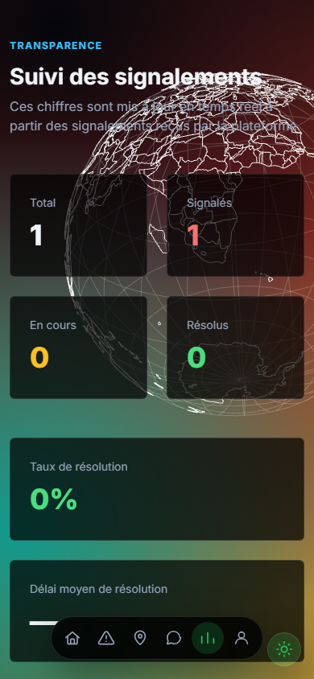       |
| Contact         | 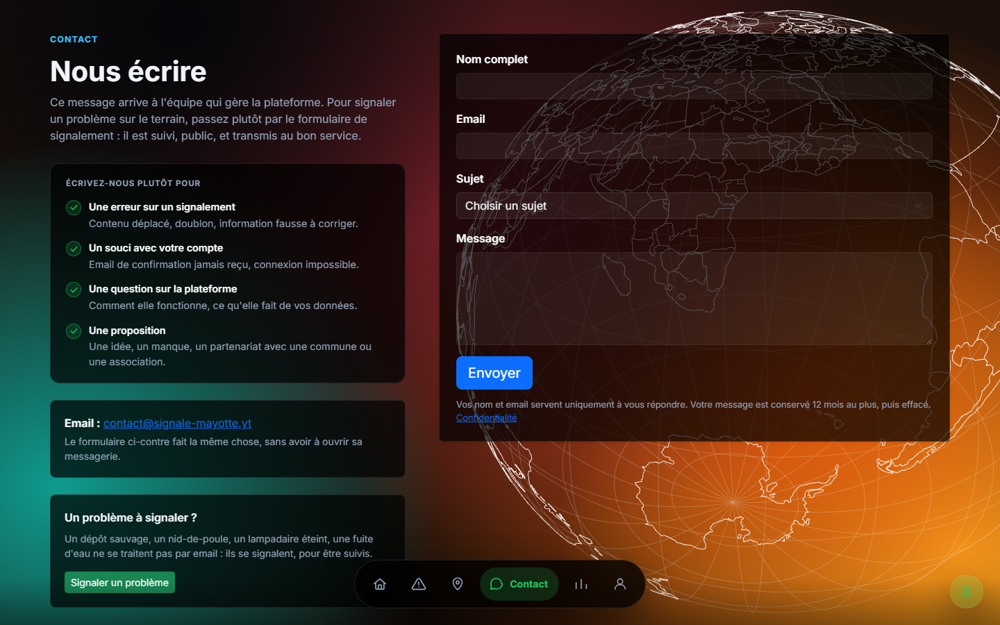                 | 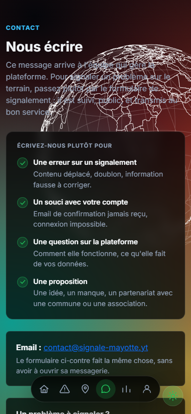                 |
| Inscription     | 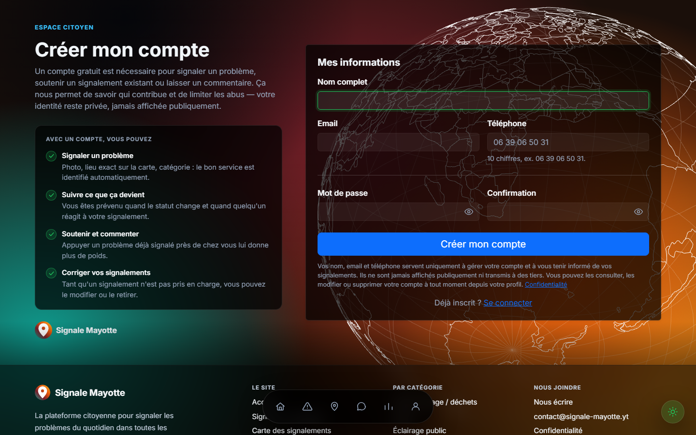         | 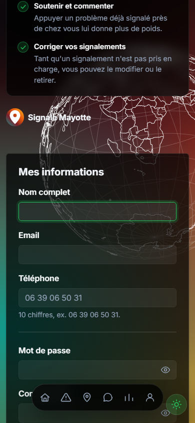         |
| Connexion admin | 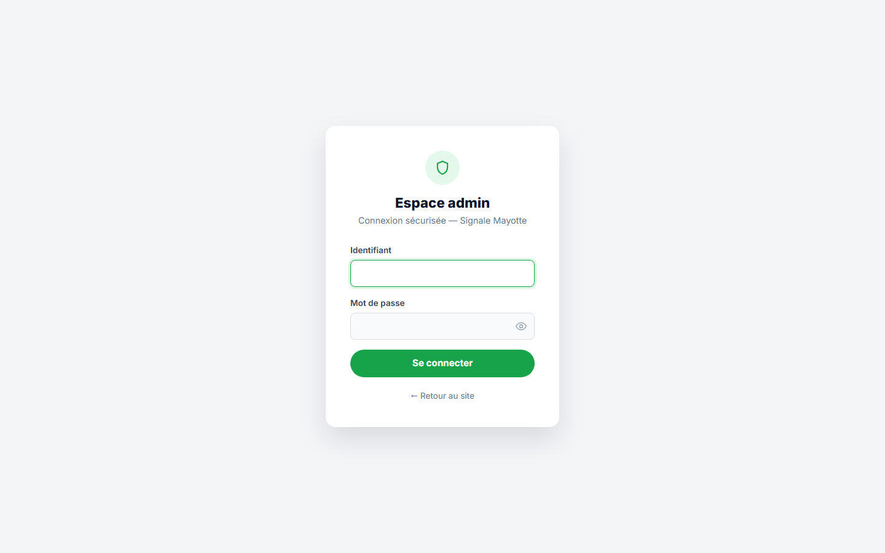 | 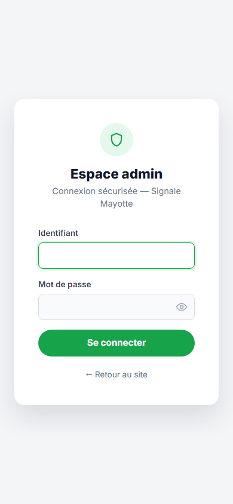 |

L'espace d'administration utilise volontairement un fond clair, sobre, distinct du site
public : on voit tout de suite qu'on n'est plus sur la partie citoyenne.

## 4. Charte graphique

| Élément          | Valeur                                                           | Usage                           |
| ---------------- | ---------------------------------------------------------------- | ------------------------------- |
| Fond             | `#000000`                                                        | Thème sombre par défaut         |
| Texte principal  | `#f1f5f9` / `#f8fafc`                                            | Corps et titres                 |
| Texte secondaire | `#94a3b8`                                                        | Légendes, dates                 |
| Couleur primaire | `#38bdf8` (bleu lagon)                                           | Liens, boutons, éléments actifs |
| Accent           | `#22c55e` (vert)                                                 | Succès, statut « Résolu »       |
| Panneaux         | verre dépoli `rgba(0,0,0,0.7)` + bordure `rgba(255,255,255,0.1)` | Cartes, formulaires             |
| Police           | **Inter**, puis police système                                   | Lisible sur petit écran         |

Un **thème clair** est proposé (bouton soleil/lune), et le choix est mémorisé.
Les variables CSS sont centralisées dans `src/assets/css/style.css` du front-end (`frontend/`).

## 5. Accessibilité et ergonomie retenues

- Liens de navigation à icônes avec `aria-label` (« Accueil », « Signaler un problème »…).
- Contrastes clairs sur fond sombre, focus clavier visible.
- Un seul appel à l'action principal par écran (« Signaler un problème »).
- Squelettes de chargement (`SignalementCardSkeleton`) plutôt qu'un écran vide.
- Messages d'erreur proposant toujours une action (« Réessayer »).
- Formulaires : libellés explicites, validation immédiate (règles partagées client/serveur dans `shared/`).

## 6. Composants réutilisables issus du maquettage

`NavBar`, `Footer`, `Hero`, `CommentCaMarche`, `FilterBar`, `SignalementCard`,
`SignalementCardSkeleton`, `StatutSuivi`, `PhotoDropzone`, `LocationPicker`,
`ChampMotDePasse` + `JaugeMotDePasse`, `CaptchaTurnstile`, `ClocheNotifications`,
`ThemeToggle`, `DialogueGlobal`, `PanneauAide`, `OrganismeCompetent`, `JournalActivite`.
